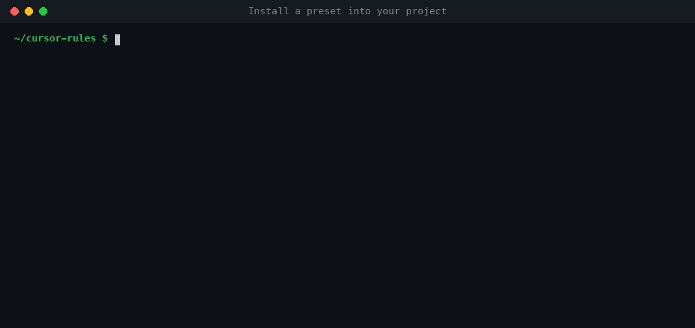
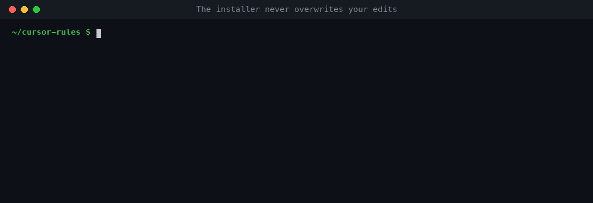
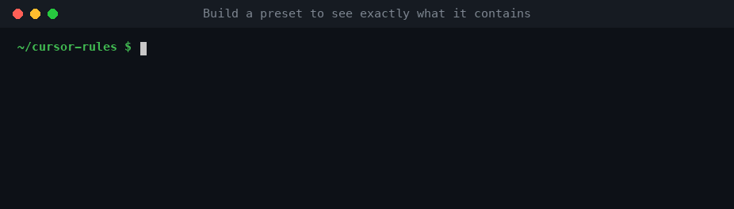
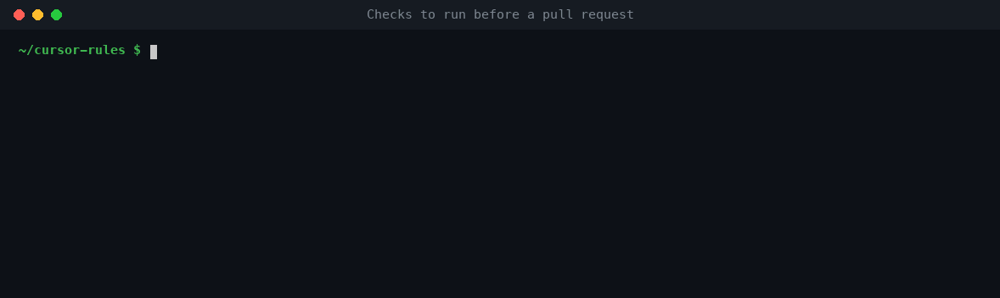

# Cursor Rules and Agent Skills for AI Coding Agents

**English** | [简体中文](./docs/i18n/README.zh-CN.md) | [हिन्दी](./docs/i18n/README.hi.md) | [Español](./docs/i18n/README.es.md) | [العربية](./docs/i18n/README.ar.md) | [Français](./docs/i18n/README.fr.md) | [বাংলা](./docs/i18n/README.bn.md) | [Português](./docs/i18n/README.pt-BR.md) | [Русский](./docs/i18n/README.ru.md) | [اردو](./docs/i18n/README.ur.md)

**Version-aware, security-first rules for Cursor, Claude Code, OpenAI Codex, GitHub Copilot and Gemini CLI.** Open source (MIT), maintained by [Phaedra Solutions](https://phaedrasolutions.com).

`cursor-rules` is a library of coding rules and [Agent Skills](https://agentskills.io) that make AI coding agents work like a senior engineer on your stack. Before an agent writes code, each rule checks which framework version your project actually uses. It then applies current conventions, security controls and known-vulnerability checks for that version. For old or end-of-life versions it switches to legacy guidance and a migration path. One source builds Cursor project rules (`.mdc`), `AGENTS.md`, `CLAUDE.md` and Agent Skills (`SKILL.md`), so every tool on your team follows the same instructions.

Questions or project work: [hello@phaedrasolutions.com](mailto:hello@phaedrasolutions.com).

## At a glance

| | |
|---|---|
| **What it is** | Rules for AI coding agents (coding standards, security, testing, version checks) plus on-demand skills (audits, upgrades, migrations) |
| **Works with** | Cursor, Claude Code, OpenAI Codex, GitHub Copilot, Gemini CLI and any tool that reads `AGENTS.md` or Agent Skills |
| **Stacks** | TypeScript, React, Next.js, Angular, Vue, Nuxt, Svelte, Astro, React Native, Expo, Flutter, SwiftUI, Jetpack Compose, Node.js, Express, NestJS, Fastify, Hono, Python, FastAPI, Django, PHP, Laravel, Java, Spring Boot, C#, ASP.NET Core, Go, Supabase, Postgres, Prisma, Drizzle, MongoDB, Firebase, Docker, Kubernetes, Terraform, GitHub Actions, AWS, GCP, Azure, WordPress, LLM apps, RAG, AI agents, MCP servers, and more |
| **Legacy coverage** | AngularJS, Create React App, class components, jQuery, Vue 2, Express 4, Node.js ≤ 20, PHP ≤ 8.2, Django ≤ 4.2, Python 2.7, Rails ≤ 7.2, Struts, .NET Framework, Xamarin, Cordova, and more |
| **Security** | OWASP Top 10:2025, CWE Top 25, supply-chain hardening, prompt-injection defenses for agents, dated CVE tables with minimum safe versions |
| **Install** | `node scripts/install.mjs --preset <name>`: Node.js 22+, zero dependencies, no npm package |
| **License** | MIT |

## Contents

- [Why version-aware rules](#why-version-aware-rules)
- [How it works](#how-it-works)
- [Works with](#works-with)
- [Quick start](#quick-start)
- [Presets](#presets)
- [Supported stacks](#supported-stacks)
- [Catalog](#catalog)
- [Security](#security)
- [Keep your tools updated](#keep-your-tools-updated)
- [FAQ](#faq)
- [Contributing](#contributing)
- [License](#license)

## Why version-aware rules

AI coding agents are trained on years of mixed examples, so they often write code for the wrong version. They use `middleware.ts` in a Next.js 16 app, NgModules in Angular 22, or `getServerSideProps` where the App Router is in use. They also add packages that don't exist, skip authorization checks and copy patterns with known CVEs.

Generic rule files make this worse. They assume one version, go stale within months and say nothing about security. These rules take a different approach:

- **Check the version first.** Every stack rule starts by reading the installed version from the lockfile or manifest. It then names the rule and version it's applying.
- **Stay current.** Each rule lists the version range it was written for (`applies_to`), its sources and a `last_reviewed` date. A weekly job flags rules whose range falls behind a new major release or an end-of-life date.
- **Handle legacy code safely.** When a project is below a rule's range, the agent follows a `legacy/` rule instead. It makes minimal, behavior-preserving changes, never uses APIs newer than what's installed, reports the EOL status, adds compensating controls for unfixed CVEs and proposes a migration skill.
- **Build in security.** OWASP-mapped secure-coding rules are always on. Every stack rule adds its own security section and a dated known-vulnerabilities table.

## How it works

Rules and skills are written once in `rules/` and `skills/`, then built for each tool.

1. **Core rules are always on.** `core/behavior`, `core/security-baseline`, `core/supply-chain` and `core/agent-safety` load in every session.
2. **Stack rules attach by file pattern.** Editing `app/page.tsx` loads `frontend/nextjs`; editing `supabase/migrations/*.sql` loads `data/supabase`. In tools without file-scoped rules (Codex, Gemini CLI), each stack rule is shipped as a `<stack>-conventions` skill that loads on demand.
3. **The rule checks the version.** The agent reads the lockfile and states what it's applying, for example:

   ```text
   Applying frontend/nextjs (next 16.4.1, react 19.2.8, from pnpm-lock.yaml).
   ```

4. **Legacy rules take over below the range.** On Next.js 15 or a `pages/` directory, the agent follows `legacy/nextjs-pages-router` and `core/legacy-mode`.
5. **Skills run on demand.** Procedures such as `security-audit`, `cve-check`, `upgrade-nextjs` or `migrate-cra-to-vite` stay out of context until you or the agent invoke them, so a large skill library costs almost nothing.

More specific rules beat more general ones, and security rules beat convenience rules unless you explicitly override them. When you do, the agent says so.

Every rule follows the same structure: **Version check**, **Conventions**, **Security**, **Known vulnerabilities**, **Testing** and **Before you finish**, which lists the exact lint, typecheck, test and audit commands to run. Legacy rules add a **Migration path**.

## Works with

| Tool | What gets installed | Where the tool reads it |
|---|---|---|
| **Cursor** (3.1.2 or later) | Project rules and skills | `.cursor/rules/**/*.mdc`, `.cursor/skills/` |
| **OpenAI Codex, GitHub Copilot, Gemini CLI** and other `AGENTS.md` tools | `AGENTS.md` (core rules plus a stack index) and skills | `AGENTS.md`, `.agents/skills/` |
| **Claude Code** | `CLAUDE.md` that imports `AGENTS.md`, plus skills | `CLAUDE.md`, `.claude/skills/` |

## Quick start

Requires Node.js 22 or later. The scripts have no dependencies.

1. Clone a release tag:

   ```bash
   git clone --branch v1.0.0 https://github.com/Phaedra-Solutions/cursor-rules.git
   cd cursor-rules
   ```

2. Preview what a preset installs into your project:

   ```bash
   node scripts/install.mjs --preset next-supabase --tool cursor,agents --dest ../my-app --dry-run
   ```

3. Install it:

   ```bash
   node scripts/install.mjs --preset next-supabase --tool cursor,agents --dest ../my-app
   ```



Options:

- `--preset`: one of the [presets](#presets). Leave it out to install everything.
- `--tool`: any of `cursor`, `agents` (`AGENTS.md` and `.agents/skills/`) and `claude` (`CLAUDE.md` and `.claude/skills/`). The default is `cursor,agents`.
- `--dry-run`: prints every planned copy without writing anything. Run it first.
- `--force`: overwrites files that differ. Without it, the script writes nothing if any file conflicts. If your project already has a `CLAUDE.md`, add the line `@AGENTS.md` to it instead of overwriting it.

The installer records the version, preset and manifest hash in `.cursor/rules/.cursor-rules-version` (or under `.agents/` or `.claude/`), so you can always tell which release a project uses.



**Without cloning:** download the archive for your tool from a [GitHub Release](https://github.com/Phaedra-Solutions/cursor-rules/releases), check it against `SHA256SUMS` (`sha256sum -c SHA256SUMS --ignore-missing`), and copy its contents into your project root.

**To see the output first:** run `node scripts/build.mjs --preset <name>` and look in `dist/`.



Pin a release tag and update deliberately; the [CHANGELOG](./CHANGELOG.md) lists what changed.

## Presets

A preset bundles the core rules, the stack rules and the skills for one kind of project. Pick the one closest to your stack; `all-core` works with any project. The core rules are always on, and stack rules load only when you edit matching files, so extra rules don't fill the agent's context.

<!-- presets:start (generated by node scripts/build.mjs --catalog; do not edit) -->

| Preset | Stack | Rules | Skills |
|---|---|---|---|
| [`ai-app`](./presets/ai-app.yml) | LLM features, RAG, agents and MCP servers (TypeScript or Python). | 14 | 7 |
| [`all-core`](./presets/all-core.yml) | Core rules and security skills only; works with any stack. | 5 | 7 |
| [`laravel`](./presets/laravel.yml) | Laravel 13 on PHP 8.3+. | 9 | 9 |
| [`nest-angular`](./presets/nest-angular.yml) | NestJS API with an Angular front end. | 18 | 9 |
| [`next-supabase`](./presets/next-supabase.yml) | Next.js App Router with Supabase, TypeScript and Tailwind. | 16 | 9 |
| [`python-fastapi`](./presets/python-fastapi.yml) | Python API with FastAPI, Pydantic v2 and SQLAlchemy 2. | 12 | 8 |
| [`react-vite`](./presets/react-vite.yml) | React single-page app built with Vite. | 15 | 8 |
| [`rn-expo`](./presets/rn-expo.yml) | React Native with Expo (New Architecture). | 12 | 8 |

<!-- presets:end -->

## Supported stacks

Each stack has a modern rule; most have a legacy rule and an upgrade or migration skill. The [catalog](#catalog) has the exact version ranges.

- **Languages:** TypeScript, JavaScript on Node.js, Python, PHP, Java, Kotlin, C#, Go, Dart, Swift, shell scripts.
- **Frontend:** React 19, Next.js 16 (App Router), React with Vite, Angular, Vue 3, Nuxt 4, Svelte 5 and SvelteKit, Astro, Tailwind CSS 4, shadcn/ui and Radix, forms and validation (React Hook Form, Zod, Standard Schema), state and server data (TanStack Query, Zustand, Redux Toolkit).
- **Mobile:** React Native and Expo (New Architecture), Flutter, SwiftUI, Jetpack Compose, mobile security (OWASP MASVS).
- **Backend:** NestJS (core, microservices, data access), Express 5, Fastify, Hono, FastAPI, Django, Laravel, Spring Boot, ASP.NET Core, Go HTTP services, GraphQL.
- **Data:** Supabase, PostgreSQL, Prisma, Drizzle, Sequelize, TypeORM, SQLAlchemy, MongoDB and Mongoose, Firebase.
- **Testing:** Cypress, Playwright, Vitest and Jest, pytest, accessibility checks (axe-core, WCAG 2.2).
- **DevOps and cloud:** GitHub Actions, Docker, Kubernetes, Terraform and OpenTofu, AWS, Google Cloud, Azure, Vercel, Netlify, Cloudflare Workers.
- **AI:** LLM apps, RAG, AI agents, MCP servers (OWASP Top 10 for LLM and Agentic Applications).
- **CMS:** WordPress plugins and themes.
- **Legacy:** AngularJS, Angular NgModules, Create React App and class components, Next.js Pages Router, React Native old architecture, jQuery, Vue 2 and Nuxt 2/3, Express 4, Node.js 20 and older, NestJS 11 and Bull, PHP 8.2 and older with Laravel 11 and CodeIgniter 3, Python 2.7, Django 4.2, Rails 7.2 and older, Java 8/11/17 with Spring Boot 2/3, Apache Struts, .NET 8/9, .NET Framework (Web Forms, WCF, ASMX), Xamarin, Apache Cordova, Flutter 2, Supabase legacy keys, the retired ingress-nginx controller, Moment.js and other maintenance-mode libraries.

## Catalog

Generated from the rule and skill files. Each rule's **Applies to** is the version range it was written for; outside that range the agent follows `core/legacy-mode` or the matching `legacy/` rule. **Tier** is the rule's priority, from P0 (most used stacks, covered by evals) to P3 (backlog).

<!-- catalog:start (generated by node scripts/build.mjs --catalog; do not edit) -->

95 rules (24 of them for legacy versions), 32 skills and 1 optional convention overlay. "Evals" marks rules with a promptfoo suite in [evals/](./evals/README.md).

### Core

| Rule | Covers | Applies to | Tier | Status | Evals |
|---|---|---|---|---|---|
| [`core/agent-safety`](./rules/core/agent-safety.md) | Agent safety | any | P0 | always on | yes |
| [`core/behavior`](./rules/core/behavior.md) | Core behavior | any | P0 | always on | yes |
| [`core/legacy-mode`](./rules/core/legacy-mode.md) | Legacy mode | any | P0 | active | yes |
| [`core/security-baseline`](./rules/core/security-baseline.md) | Security baseline | any | P0 | always on | yes |
| [`core/supply-chain`](./rules/core/supply-chain.md) | Supply chain | any | P0 | always on | yes |

### Languages

| Rule | Covers | Applies to | Tier | Status | Evals |
|---|---|---|---|---|---|
| [`languages/csharp`](./rules/languages/csharp.md) | C# | any | P2 | active |  |
| [`languages/dart`](./rules/languages/dart.md) | Dart | any | P2 | active |  |
| [`languages/go`](./rules/languages/go.md) | Go | go >=1.26 <1.28 | P2 | active |  |
| [`languages/java`](./rules/languages/java.md) | Java | any | P2 | active |  |
| [`languages/javascript-node`](./rules/languages/javascript-node.md) | JavaScript on Node.js | node >=22 <27 | P1 | active |  |
| [`languages/kotlin`](./rules/languages/kotlin.md) | Kotlin | any | P2 | active |  |
| [`languages/php`](./rules/languages/php.md) | PHP | php >=8.3 <9 | P1 | active |  |
| [`languages/python`](./rules/languages/python.md) | Python | python >=3.11 <3.16 | P1 | active |  |
| [`languages/shell`](./rules/languages/shell.md) | Shell scripts (POSIX sh and Bash) | any | P2 | active |  |
| [`languages/swift`](./rules/languages/swift.md) | Swift | any | P2 | active |  |
| [`languages/typescript`](./rules/languages/typescript.md) | TypeScript | typescript >=6.0 <8 | P0 | active | yes |

### Frontend

| Rule | Covers | Applies to | Tier | Status | Evals |
|---|---|---|---|---|---|
| [`frontend/angular`](./rules/frontend/angular.md) | Angular | @angular/core >=20.0 <23 | P0 | active | yes |
| [`frontend/astro`](./rules/frontend/astro.md) | Astro 7 | astro >=7.0 <8 | P2 | active |  |
| [`frontend/forms-validation`](./rules/frontend/forms-validation.md) | Forms and validation | any | P1 | active |  |
| [`frontend/nextjs`](./rules/frontend/nextjs.md) | Next.js (App Router) | next >=16.0 <17 | P0 | active | yes |
| [`frontend/nuxt`](./rules/frontend/nuxt.md) | Nuxt 4 | nuxt >=4.0 <5 | P1 | active |  |
| [`frontend/react`](./rules/frontend/react.md) | React | react >=19.0 <20 | P0 | active | yes |
| [`frontend/react-vite-spa`](./rules/frontend/react-vite-spa.md) | React single-page app with Vite | vite >=7.0 <9 | P0 | active | yes |
| [`frontend/state-and-data`](./rules/frontend/state-and-data.md) | React state and server data | any | P2 | active |  |
| [`frontend/svelte`](./rules/frontend/svelte.md) | Svelte 5 and SvelteKit 3 | svelte >=5.0 <6, @sveltejs/kit >=3.0 <4 | P2 | active |  |
| [`frontend/tailwind`](./rules/frontend/tailwind.md) | Tailwind CSS 4 | tailwindcss >=4.0 <5 | P1 | active |  |
| [`frontend/ui-shadcn-radix`](./rules/frontend/ui-shadcn-radix.md) | shadcn/ui and Radix UI | any | P2 | active |  |
| [`frontend/vue`](./rules/frontend/vue.md) | Vue 3 | vue >=3.4 <4 | P1 | active |  |

### Backend

| Rule | Covers | Applies to | Tier | Status | Evals |
|---|---|---|---|---|---|
| [`backend/aspnet-core`](./rules/backend/aspnet-core.md) | ASP.NET Core | nuget:Microsoft.AspNetCore.App.Ref >=10.0 <11 | P2 | active |  |
| [`backend/django`](./rules/backend/django.md) | Django | pypi:django >=5.2 <6.2 | P1 | active |  |
| [`backend/express`](./rules/backend/express.md) | Express 5 | express >=5.0 <6 | P1 | active |  |
| [`backend/fastapi`](./rules/backend/fastapi.md) | FastAPI | pypi:fastapi >=0.115 <1 | P1 | active |  |
| [`backend/fastify-hono`](./rules/backend/fastify-hono.md) | Fastify and Hono | fastify >=5.0 <6, hono >=4.0 <5 | P2 | active |  |
| [`backend/go-http`](./rules/backend/go-http.md) | Go HTTP services | go >=1.26 <1.28 | P2 | active |  |
| [`backend/graphql`](./rules/backend/graphql.md) | GraphQL APIs | any | P2 | active |  |
| [`backend/laravel`](./rules/backend/laravel.md) | Laravel | packagist:laravel/framework >=12.0 <14, php >=8.3 <9 | P1 | active |  |
| [`backend/nestjs`](./rules/backend/nestjs.md) | NestJS | @nestjs/core >=12.0 <13 | P0 | active | yes |
| [`backend/nestjs-data`](./rules/backend/nestjs-data.md) | NestJS data access (Sequelize, TypeORM, Prisma) | @nestjs/core >=12.0 <13 | P0 | active | yes |
| [`backend/nestjs-microservices`](./rules/backend/nestjs-microservices.md) | NestJS microservices, real-time events and queues | @nestjs/microservices >=12.0 <13 | P0 | active | yes |
| [`backend/spring-boot`](./rules/backend/spring-boot.md) | Spring Boot | maven:org.springframework.boot:spring-boot >=4.0 <5 | P2 | active |  |

### Data

| Rule | Covers | Applies to | Tier | Status | Evals |
|---|---|---|---|---|---|
| [`data/firebase`](./rules/data/firebase.md) | Firebase (Firestore, Storage, Auth, Functions) | firebase >=12.0 <14, firebase-admin >=13.0 <15 | P2 | active |  |
| [`data/mongodb`](./rules/data/mongodb.md) | MongoDB and Mongoose | mongoose >=8.0 <10, mongodb >=6.0 <8 | P2 | active |  |
| [`data/orm-drizzle`](./rules/data/orm-drizzle.md) | Drizzle ORM | drizzle-orm >=0.44 <2 | P2 | active |  |
| [`data/orm-prisma`](./rules/data/orm-prisma.md) | Prisma ORM 7 | @prisma/client >=7.0 <8 | P1 | active |  |
| [`data/orm-sequelize-typeorm`](./rules/data/orm-sequelize-typeorm.md) | Sequelize and TypeORM | sequelize >=6.0 <8, typeorm >=0.3 <2 | P2 | active |  |
| [`data/postgres`](./rules/data/postgres.md) | PostgreSQL schema, migrations and queries | postgresql >=14 <19 | P1 | active |  |
| [`data/sqlalchemy`](./rules/data/sqlalchemy.md) | SQLAlchemy 2 and Alembic | pypi:sqlalchemy >=2.0 <2.2 | P2 | active |  |
| [`data/supabase`](./rules/data/supabase.md) | Supabase | supabase >=2.0 <3 | P0 | active | yes |

### Mobile

| Rule | Covers | Applies to | Tier | Status | Evals |
|---|---|---|---|---|---|
| [`mobile/android-compose`](./rules/mobile/android-compose.md) | Android with Jetpack Compose | any | P2 | active |  |
| [`mobile/flutter`](./rules/mobile/flutter.md) | Flutter | any | P1 | active |  |
| [`mobile/ios-swiftui`](./rules/mobile/ios-swiftui.md) | iOS with SwiftUI | any | P2 | active |  |
| [`mobile/mobile-security`](./rules/mobile/mobile-security.md) | Mobile app security (MASVS) | any | P1 | active |  |
| [`mobile/react-native-expo`](./rules/mobile/react-native-expo.md) | React Native + Expo | react-native >=0.82 <0.89, expo >=55.0 <59 | P0 | active | yes |

### Testing

| Rule | Covers | Applies to | Tier | Status | Evals |
|---|---|---|---|---|---|
| [`testing/a11y`](./rules/testing/a11y.md) | Accessibility checks (axe-core, WCAG 2.2) | axe-core >=4.10 <5 | P2 | active |  |
| [`testing/cypress`](./rules/testing/cypress.md) | Cypress | cypress >=15.0 <17 | P0 | active | yes |
| [`testing/playwright`](./rules/testing/playwright.md) | Playwright Test | @playwright/test >=1.50 <2 | P1 | active |  |
| [`testing/pytest`](./rules/testing/pytest.md) | Python tests (pytest) | pytest >=8.4 <10 | P2 | active |  |
| [`testing/unit-js`](./rules/testing/unit-js.md) | Unit and component tests (Vitest, Jest) | vitest >=4.0 <6, jest >=29 <31 | P1 | active |  |

### DevOps and cloud

| Rule | Covers | Applies to | Tier | Status | Evals |
|---|---|---|---|---|---|
| [`devops/cloud-aws`](./rules/devops/cloud-aws.md) | AWS infrastructure and SDK configuration | any | P2 | active |  |
| [`devops/cloud-azure`](./rules/devops/cloud-azure.md) | Azure infrastructure and SDK configuration | any | P2 | active |  |
| [`devops/cloud-gcp`](./rules/devops/cloud-gcp.md) | Google Cloud infrastructure and SDK configuration | any | P2 | active |  |
| [`devops/docker`](./rules/devops/docker.md) | Docker images and Compose | any | P1 | active |  |
| [`devops/github-actions`](./rules/devops/github-actions.md) | GitHub Actions | any | P0 | active | yes |
| [`devops/kubernetes`](./rules/devops/kubernetes.md) | Kubernetes manifests and Helm charts | any | P2 | active |  |
| [`devops/terraform-opentofu`](./rules/devops/terraform-opentofu.md) | Terraform and OpenTofu | any | P2 | active |  |
| [`devops/vercel-netlify-cloudflare`](./rules/devops/vercel-netlify-cloudflare.md) | Vercel, Netlify and Cloudflare Workers deployments | any | P2 | active |  |

### AI

| Rule | Covers | Applies to | Tier | Status | Evals |
|---|---|---|---|---|---|
| [`ai/agents`](./rules/ai/agents.md) | AI agents and tool-using workflows | any | P1 | active |  |
| [`ai/llm-apps`](./rules/ai/llm-apps.md) | LLM features in applications | any | P0 | active | yes |
| [`ai/mcp-servers`](./rules/ai/mcp-servers.md) | Building MCP servers | any | P1 | active |  |
| [`ai/rag`](./rules/ai/rag.md) | Retrieval-augmented generation (RAG) | any | P1 | active |  |

### CMS and commerce

| Rule | Covers | Applies to | Tier | Status | Evals |
|---|---|---|---|---|---|
| [`cms-commerce/wordpress`](./rules/cms-commerce/wordpress.md) | WordPress plugins and themes | wordpress >=6.8 <8, php >=8.2 <9 | P2 | active |  |

### Legacy

| Rule | Covers | Applies to | Tier | Status | Evals |
|---|---|---|---|---|---|
| [`legacy/angular-ngmodules`](./rules/legacy/angular-ngmodules.md) | Angular NgModule apps and Angular 19 or older | @angular/core >=2.0 <23 | P0 | legacy | yes |
| [`legacy/angularjs`](./rules/legacy/angularjs.md) | AngularJS 1.x | angular >=1.0 <2 | P0 | legacy | yes |
| [`legacy/cordova`](./rules/legacy/cordova.md) | Apache Cordova apps | cordova-android >=9.0 <16 | P2 | legacy |  |
| [`legacy/django-legacy`](./rules/legacy/django-legacy.md) | Django 4.2 and older | pypi:django >=1.11 <5.2 | P1 | legacy |  |
| [`legacy/dotnet-8-9`](./rules/legacy/dotnet-8-9.md) | .NET 8 and .NET 9 near end of support | nuget:Microsoft.NETCore.App.Ref >=3.0 <10 | P2 | legacy |  |
| [`legacy/dotnet-framework`](./rules/legacy/dotnet-framework.md) | .NET Framework 4.x, Web Forms, WCF and ASMX | any | P2 | legacy |  |
| [`legacy/express-4`](./rules/legacy/express-4.md) | Express 4 | express >=4.0 <5 | P1 | legacy |  |
| [`legacy/flutter-legacy`](./rules/legacy/flutter-legacy.md) | Flutter 2 and pre-null-safety Dart | any | P1 | legacy |  |
| [`legacy/ingress-nginx`](./rules/legacy/ingress-nginx.md) | ingress-nginx (retired) | any | P2 | legacy |  |
| [`legacy/java-spring-boot-legacy`](./rules/legacy/java-spring-boot-legacy.md) | Java 8/11/17 and Spring Boot 2.x/3.x | maven:org.springframework.boot:spring-boot >=2.0 <4 | P2 | legacy |  |
| [`legacy/jquery`](./rules/legacy/jquery.md) | jQuery 1-3 (and jQuery 4) | jquery >=1.0 <5 | P1 | legacy |  |
| [`legacy/js-legacy-libraries`](./rules/legacy/js-legacy-libraries.md) | Maintenance-mode and deprecated JavaScript libraries | any | P2 | legacy |  |
| [`legacy/nestjs-legacy`](./rules/legacy/nestjs-legacy.md) | NestJS 11 and older, and Bull queues | @nestjs/core >=8.0 <12 | P0 | legacy | yes |
| [`legacy/nextjs-pages-router`](./rules/legacy/nextjs-pages-router.md) | Next.js Pages Router and Next.js 15 or older | next >=12.0 <17 | P0 | legacy | yes |
| [`legacy/node-legacy`](./rules/legacy/node-legacy.md) | Node.js 20 and older, and non-LTS lines | node >=12 <22 | P1 | legacy |  |
| [`legacy/php-legacy`](./rules/legacy/php-legacy.md) | PHP 8.2 and older, Laravel 11 and older, CodeIgniter 3 | php >=5.6 <8.3 | P1 | legacy |  |
| [`legacy/python-legacy`](./rules/legacy/python-legacy.md) | Python 2.7 and end-of-life Python 3 | python >=2.7 <3.11 | P1 | legacy |  |
| [`legacy/rails-legacy`](./rules/legacy/rails-legacy.md) | Rails 7.2 and older | any | P2 | legacy |  |
| [`legacy/react-class-cra`](./rules/legacy/react-class-cra.md) | React class components, legacy Redux and Create React App | react-scripts >=1.0 <6 | P0 | legacy | yes |
| [`legacy/react-native-old-arch`](./rules/legacy/react-native-old-arch.md) | React Native old architecture and bare React Native CLI apps | react-native <0.82 | P0 | legacy | yes |
| [`legacy/struts`](./rules/legacy/struts.md) | Apache Struts 1 and 2 | maven:org.apache.struts:struts2-core >=2.0 <8 | P2 | legacy |  |
| [`legacy/supabase-legacy`](./rules/legacy/supabase-legacy.md) | Supabase on legacy API keys and import maps | supabase >=1.0 <3 | P0 | legacy | yes |
| [`legacy/vue2-nuxt2`](./rules/legacy/vue2-nuxt2.md) | Vue 2, Nuxt 2 and Nuxt 3 | vue >=2.0 <3 | P1 | legacy |  |
| [`legacy/xamarin`](./rules/legacy/xamarin.md) | Xamarin and Xamarin.Forms | nuget:Xamarin.Forms >=1.0 <6 | P2 | legacy |  |

### Skills

| Skill | What it does |
|---|---|
| [`cve-check`](./skills/cve-check/SKILL.md) | Look up known vulnerabilities for a specific package@version in OSV, the GitHub Advisory Database and the vendor's security page, and report each advisory's ID, severity, affected and fixed versions and exploitation sta… |
| [`dependency-vet`](./skills/dependency-vet/SKILL.md) | Vet a package before it is added to a project. |
| [`git-commit`](./skills/git-commit/SKILL.md) | Write and make a git commit. |
| [`incident-supply-chain`](./skills/incident-supply-chain/SKILL.md) | Respond to a suspected compromised dependency, GitHub Action or developer tool. |
| [`migrate-angularjs`](./skills/migrate-angularjs/SKILL.md) | Plan and run a migration off AngularJS 1.x (EOL since 31 Dec 2021, unfixed CVEs) to Angular - choose between an incremental hybrid with ngUpgrade (@angular/upgrade), a per-route strangler rewrite, or a full rewrite; pre… |
| [`migrate-class-to-hooks`](./skills/migrate-class-to-hooks/SKILL.md) | Convert React class components to function components with hooks one component at a time - characterization tests first, then map state to useState/useReducer, lifecycle methods to useEffect with correct dependencies an… |
| [`migrate-cordova`](./skills/migrate-cordova/SKILL.md) | Migrate an Apache Cordova app to Capacitor 8 in place - inventory plugins and config.xml preferences, add Capacitor alongside the existing web layer (npx cap init, add android and ios), map each Cordova plugin to an off… |
| [`migrate-cra-to-vite`](./skills/migrate-cra-to-vite/SKILL.md) | Move a Create React App (react-scripts) project to Vite - install Vite and @vitejs/plugin-react, move index.html to the project root with a module script, rename REACT_APP_ env variables to VITE_ and process.env to impo… |
| [`migrate-dotnet-framework`](./skills/migrate-dotnet-framework/SKILL.md) | Migrate a .NET Framework 4.x application (ASP.NET Web Forms, MVC 5, Web API 2, WCF, ASMX, Windows services) to .NET 10 incrementally - assessment of projects, System.Web and WCF usage and package support, libraries to n… |
| [`migrate-ingress-nginx`](./skills/migrate-ingress-nginx/SKILL.md) | Move a cluster off the retired community ingress-nginx controller to Gateway API - inventory Ingresses, classes and nginx.ingress.kubernetes.io annotations; choose and install a Gateway API implementation side by side;… |
| [`migrate-struts`](./skills/migrate-struts/SKILL.md) | Move an application off Apache Struts - either upgrade Struts 2 to a supported line (2.5 → 6.12 → 7.4) or replace Struts 1/2 with Spring MVC on Spring Boot incrementally - with an inventory of actions, forms, validation… |
| [`migrate-vue2`](./skills/migrate-vue2/SKILL.md) | Migrate a Vue 2 app to Vue 3 with the official @vue/compat migration build, step by step - move to Vue 2.7 and replace Vue 3-incompatible libraries first, switch the build to Vue 3 plus @vue/compat in MODE 2, fix compat… |
| [`migrate-xamarin`](./skills/migrate-xamarin/SKILL.md) | Migrate a Xamarin.Forms, Xamarin.iOS or Xamarin.Android app to .NET MAUI 10 (or .NET for iOS/Android) - inventory packages, renderers and platform code; move shared code to SDK-style libraries; create a MAUI single proj… |
| [`secrets-scan`](./skills/secrets-scan/SKILL.md) | Scan staged changes, the working tree or git history for leaked secrets with gitleaks, and guide the user through revoking and rotating anything found, then optionally removing it from history. |
| [`security-audit`](./skills/security-audit/SKILL.md) | Audit a project's dependencies, code, secrets, containers and CI config for known vulnerabilities, triage findings by severity, reachability and active exploitation, and write security-report.md with the smallest safe f… |
| [`threat-model-lite`](./skills/threat-model-lite/SKILL.md) | Run a 10-minute STRIDE pass on a new feature or significant change and produce a table of assets, entry points, abuse cases, required controls mapped to OWASP Top 10:2025, and tests to add. |
| [`upgrade-angular`](./skills/upgrade-angular/SKILL.md) | Upgrade an Angular app one major version at a time with ng update and the official update guide, then optionally run the standalone, control-flow, inject() and signal migrations, adopt zoneless change detection and move… |
| [`upgrade-django`](./skills/upgrade-django/SKILL.md) | Upgrade a Django project one feature release at a time (for example 4.2 → 5.0 → 5.1 → 5.2 LTS, then 6.x) with django-upgrade --target-version, deprecation warnings as errors, add-on (DRF, django-cors-headers, Celery) co… |
| [`upgrade-dotnet`](./skills/upgrade-dotnet/SKILL.md) | Upgrade a .NET (Core) application or library from net8.0, net9.0 or older to net10.0 LTS - retarget the TFM and global.json, update platform packages (ASP.NET Core, EF Core, Microsoft.Extensions) to 10.x, check third-pa… |
| [`upgrade-express`](./skills/upgrade-express/SKILL.md) | Upgrade an Express 4 app to Express 5 with the official codemods from the codemod.com registry (@expressjs/v5-migration-recipe), then fix what codemods can't - path-to-regexp v8 route syntax, the simple query parser and… |
| [`upgrade-jquery`](./skills/upgrade-jquery/SKILL.md) | Upgrade jQuery 1.x/2.x/3.x to 3.7.1 and then 4.x with jQuery Migrate - find every loaded copy, upgrade plugins and jQuery UI, add the matching jQuery Migrate build in development to log deprecated and removed APIs, fix… |
| [`upgrade-laravel`](./skills/upgrade-laravel/SKILL.md) | Upgrade a Laravel app one major version at a time (for example 10 → 11 → 12 → 13) following the official upgrade guide, with PHP minimums checked first, first-party and third-party package compatibility (Livewire, Filam… |
| [`upgrade-nestjs`](./skills/upgrade-nestjs/SKILL.md) | Upgrade a NestJS app one major version at a time - manual 9 → 10 → 11 hops, then nest upgrade for 11 → 12 - keeping the module format, with ESM, Jest and path-alias checks, the Bull → BullMQ queue migration (new queues,… |
| [`upgrade-nextjs`](./skills/upgrade-nextjs/SKILL.md) | Upgrade a Next.js app one major version at a time with the official codemods, keeping React on a matching major, then verify with build, tests and a smoke test. |
| [`upgrade-node`](./skills/upgrade-node/SKILL.md) | Upgrade a project's Node.js version to a supported LTS (24 or 26) - pick the target, update .nvmrc, engines, package-manager and type versions, CI matrices, Dockerfiles and deploy runtimes together, rebuild native modul… |
| [`upgrade-nuxt`](./skills/upgrade-nuxt/SKILL.md) | Upgrade a Nuxt 3 app to Nuxt 4 (Nuxt 3 reached EOL on 31 Jul 2026) with npx nuxt upgrade and the official codemod recipe (npx codemod@0.18.7 nuxt/4/migration-recipe), then fix what codemods don't - the app/ srcDir, shal… |
| [`upgrade-php`](./skills/upgrade-php/SKILL.md) | Upgrade a project's PHP version one minor release at a time (for example 8.1 → 8.2 → 8.3 → 8.4) with Rector's PHP sets (withPhpSets), PHPStan at a fixed level with a baseline, Composer platform and dependency updates, d… |
| [`upgrade-python`](./skills/upgrade-python/SKILL.md) | Upgrade a project's Python version one minor release at a time (for example 3.10 → 3.11 → 3.12 → 3.13) with pyupgrade, deprecation warnings treated as errors, dependency re-locking, C-extension checks and every pin (req… |
| [`upgrade-rails`](./skills/upgrade-rails/SKILL.md) | Upgrade a Rails application one minor version at a time (for example 6.1 → 7.0 → 7.1 → 7.2 → 8.0 → 8.1) with dual boot through next_rails (Gemfile.next and the next command), bundle_report compatibility checks, deprecat… |
| [`upgrade-react-native`](./skills/upgrade-react-native/SKILL.md) | Upgrade a React Native or Expo app one Expo SDK (or one React Native minor for bare apps) at a time, with npx expo install --fix, the Upgrade Helper diff, per-library New Architecture readiness checks, expo prebuild --c… |
| [`upgrade-spring-boot`](./skills/upgrade-spring-boot/SKILL.md) | Upgrade a Spring Boot application one major step at a time (2.7 → 3.5 → 4.0 → 4.1) and its JDK (8/11/17 → 21 or 25) with OpenRewrite recipes run through the rewrite Maven or Gradle plugin (UpgradeToJava21, UpgradeSpring… |
| [`upgrade-supabase`](./skills/upgrade-supabase/SKILL.md) | Move a Supabase project off the legacy anon and service_role keys to publishable and secret keys (create, swap per component, update env vars, pg_net and webhook headers, Edge Function code and verify_jwt, test, then de… |

### Planned

Referenced but not written yet; until they exist, the build skips them.

| Rule | Referenced by |
|---|---|
| `testing/mobile-e2e` | preset `rn-expo` |

### Conventions

| Overlay | Covers |
|---|---|
| [`conventions/phaedra`](./conventions/phaedra.md) | Phaedra house conventions |

<!-- catalog:end -->

Also in this repo:

- [`evals/`](./evals/README.md): promptfoo suites that measure each P0 rule's effect by running the same coding prompts with and without the rule. They run locally or by manual workflow, with no paid model calls in pull-request CI.
- [`templates/ci/`](./templates/ci/README.md): security workflows to copy into your projects (GitHub Actions, GitLab CI, Dependabot).
- [`templates/package-managers/`](./templates/package-managers/): release-age cooldown settings for npm, pnpm, Yarn, Bun and uv, which block packages published in the last few days.
- The original root files (`global-rules.md`, `next-rules.md`, `react-typescript-rules.md`, `react-native-rules.md`, `angular-rules.md`, `nestjs-rules.md`, `supabase-rules.md`, `cypress-testing-rules.md`) are now stubs pointing to their replacements; their old content is in git history before `v1.0.0`.

## Security

Security is part of every rule, not a separate add-on.

- **Always-on core rules:**
  - `core/security-baseline`: secure coding grouped by OWASP Top 10:2025, with CWE Top 25 references.
  - `core/supply-chain`: never invent packages, lockfiles and frozen installs, release-age cooldowns, install-script policy and pinned CI actions.
  - `core/agent-safety`: treat fetched content as data, not instructions; secrets handling; confirmation before risky commands; MCP server allowlists.
  - `core/behavior`: scoped changes and one-line security findings, even in short answers.
- **Per-stack security:** every rule has a Security section and a dated Known vulnerabilities table with minimum safe versions. Legacy rules add compensating controls for versions that no longer get fixes.
- **Security skills:** `security-audit` (dependencies, code, secrets, containers and CI), `dependency-vet` (typosquat and hallucinated-package checks before installing), `cve-check` (OSV and GitHub Advisory lookups), `secrets-scan` (gitleaks), `threat-model-lite` (a 10-minute STRIDE pass) and `incident-supply-chain` (response to a compromised dependency).
- **For your projects:** the CI templates in [`templates/ci/`](./templates/ci/README.md) run OSV-Scanner, Semgrep, gitleaks and zizmor.
- **For this repo:** pull-request lint checks frontmatter, size, hidden Unicode, links and Markdown. A daily job checks [`security/watchlist.yml`](./security/watchlist.yml) against OSV and CISA KEV, and a weekly job checks every `applies_to` range for new releases and end-of-life dates.
- **Reporting:** see [SECURITY.md](./SECURITY.md). Don't open public issues for vulnerabilities.

## Keep your tools updated

- **Cursor:** several 2026 fixes covered sandbox escapes and prompt injection (for example CVE-2026-26268, CVE-2026-48124, CVE-2026-50548, CVE-2026-50549 and CVE-2026-73217). Use **Cursor 3.1.2 or later** and install updates when they ship. See [Cursor's security advisories](https://github.com/cursor/cursor/security/advisories).
- **Claude Code, Codex, Copilot and other agents:** keep them on current releases; `core/agent-safety` covers their configuration files and MCP servers.
- **These rules:** version and advisory tables go stale. Update to the latest release at least monthly, and use the `cve-check` skill before relying on a table.

## FAQ

### What are Cursor rules?

Cursor rules are instructions that Cursor's AI agent reads while it works in your project. Project rules live in `.cursor/rules/` as `.mdc` files with frontmatter that says when each rule applies: always, for matching file patterns (`globs`), or when the agent decides the description fits. This repo generates those files from one source, along with `AGENTS.md` and Agent Skills for other tools.

### What is the difference between a rule and a skill?

A **rule** is short, declarative guidance that must be in context whenever matching files are edited, such as "use `proxy.ts`, not `middleware.ts`" in Next.js 16. A **skill** is a step-by-step procedure run on demand, such as "audit dependencies" or "upgrade Angular one major version at a time". Only a skill's name and description stay in context until it's used.

### Does it work with Claude Code, Codex, GitHub Copilot or Gemini CLI?

Yes. Install with `--tool agents` for tools that read `AGENTS.md` and `.agents/skills/` (Codex, Copilot, Gemini CLI and others), or `--tool claude` for Claude Code, which gets a `CLAUDE.md` that imports `AGENTS.md` and skills in `.claude/skills/`. You can install for several tools at once: `--tool cursor,agents,claude`.

### Will the installer overwrite my existing files?

No. It never overwrites a file that differs unless you pass `--force`, and if anything conflicts it writes nothing. Run `--dry-run` first to see every planned copy.

### My project is on an old version. Will the rules still help?

Yes. When the installed version is below a rule's range, the agent follows the matching `legacy/` rule and `core/legacy-mode`. It keeps changes minimal, reports the end-of-life status, applies compensating controls for unpatched CVEs and suggests a migration skill, such as `migrate-angularjs`, `upgrade-express` or `migrate-dotnet-framework`. It doesn't migrate unless you ask, and it asks before changing any version, even a patch.

### How do you keep the rules current and accurate?

Every version, date and CVE claim has a source in the rule's frontmatter. A daily job checks tracked packages against OSV and the CISA Known Exploited Vulnerabilities catalog, a weekly job flags rules that fall behind new releases or end-of-life dates, and a monthly security review is opened as an issue. P0 rules have eval suites that measure how often the agent follows them.

### Can I add my team's own conventions?

Yes. Team-specific choices go in an overlay in `conventions/` that presets can include; [`conventions/phaedra.md`](./conventions/phaedra.md) is an example. Generic rules defer to the project's existing choices, so an overlay only needs what's different for your team.

### How do I add a stack that isn't covered?

Follow [CONTRIBUTING.md](./CONTRIBUTING.md), or use the reusable prompt in [`implementation-prompts/36-template-new-stack.md`](./implementation-prompts/36-template-new-stack.md) with your AI agent. New rules must pass `node scripts/lint-rules.mjs`.

### Is it free?

Yes. The repo is MIT-licensed. Content adapted from [Project CodeGuard](https://github.com/cosai-oasis/project-codeguard) keeps its CC BY 4.0 attribution in [NOTICE.md](./NOTICE.md).

## Contributing

See [CONTRIBUTING.md](./CONTRIBUTING.md) for the rule and skill templates, sourcing rules and the review process. Before opening a pull request:

```bash
node scripts/lint-rules.mjs
node --test scripts/*.test.mjs
node scripts/build.mjs
node scripts/build.mjs --catalog        # regenerates the catalog and preset tables in this README
```



The plan and its reasoning are in [ROADMAP.md](./ROADMAP.md); decisions are in [docs/decisions.md](./docs/decisions.md).

## License

[MIT](./LICENSE). Third-party attributions are listed in [NOTICE.md](./NOTICE.md).

Built and maintained by [Phaedra Solutions](https://phaedrasolutions.com), a custom software and AI development company. For help applying these rules to your codebase, contact [hello@phaedrasolutions.com](mailto:hello@phaedrasolutions.com).
